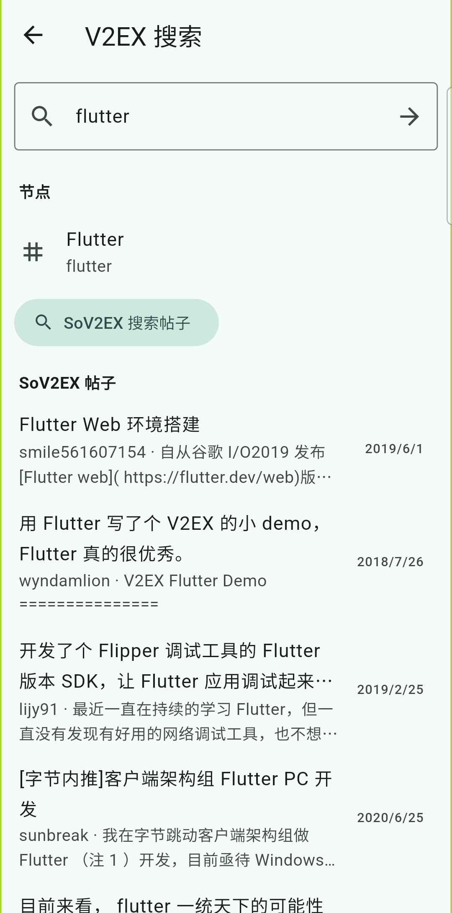

# V2DO

V2DO 是一个使用 Flutter 开发的 V2EX 与 LINUX DO 第三方客户端，界面以 Android 为优先。它与两个论坛均无官方关联。

## 界面预览

以下为 Android 实机截图，展示 V2EX 主页、主题详情、节点和搜索。截图包含论坛用户公开发布的内容；相关内容及头像属于各自权利人。

   

## 功能

- 浏览主题、节点与分类，查看正文、回复和图片，发帖与回帖。
- 回复排序、只看楼主、楼中楼展示及折叠；支持站点所提供的回复关系。
- 个人资料、收藏、消息、浏览记录；支持 V2EX 签到和余额记录。
- LINUX DO 帖子搜索；V2EX 支持应用内节点、用户建议和 SoV2EX 帖子搜索。
- LINUX DO 图片上传；V2EX 编辑器支持登录 Imgur 后上传图片。
- 主题颜色与深浅模式、图片预览与保存、启动论坛选择。

部分功能需要登录或论坛授予相应权限。WebView 用于登录与网站验证；论坛页面解析及非公开接口可能随网站调整失效。Imgur 网页登录不支持 Google 登录，需要使用账号密码。

## 平台状态

Android 已构建并在设备上测试。iOS 尚无工程和平台接口实现，不能运行或发布。

## 开发方式

本项目全程使用 OpenAI Codex 协助开发，包括需求梳理、代码编写、测试和发布准备。根据项目维护者估算，开发过程大约消耗了 ChatGPT Plus 账户的 3 个周额度；这是粗略估计，并非独立统计的精确用量或费用。截至 2026 年 11 月 17 日，本次开发会话记录了 61 轮（含本轮及 4 轮未完成的尝试），共 106 条用户消息（包含追问和选择项回复）；统计会随后续开发变化。

## Android 安装包

Release 提供通用 APK 和按 CPU 架构拆分的 APK。大多数现代 Android 手机可使用 `arm64-v8a`；较旧的 32 位 ARM 设备可使用 `armeabi-v7a`，部分模拟器可使用 `x86_64`。不确定架构时请选择通用包。所有正式 APK 使用相同应用 ID、版本号和签名。

## 构建与测试

已使用 Flutter 3.47.9、Dart 3.13.7 和 Android SDK 36 构建。

```sh
flutter pub get
flutter analyze
flutter test
flutter build apk --release
```

Android release 构建从环境变量 `V2DO_KEYSTORE`、`V2DO_STORE_PASSWORD`、`V2DO_KEY_PASSWORD` 和 `V2DO_KEY_ALIAS` 读取签名配置。密钥和密码不得提交到仓库，应由维护者妥善备份。Debug 与正式包使用不同应用 ID 和签名，可以并存；登录状态和本地数据互不共享。

应用内 GitHub Releases 更新检查需要构建时配置 `--dart-define=GITHUB_REPOSITORY=用户名/仓库名`；未配置时不会检查更新。

## 许可证与第三方内容

本项目中由项目维护者有权授权的源码和文档以 [MIT License](LICENSE) 发布，版权署名为 `wshhfy`。其他贡献者保留其贡献的相关权利。

V2EX、LINUX DO、SoV2EX、Imgur 的名称及标识属于各自权利人；截图、帖子、回复和头像等论坛内容的权利属于相应权利人。MIT 授权不会改变上述第三方内容的权利。项目包含的第三方依赖和素材遵循各自的许可与使用条件；论坛标识、官网示意图和截图的具体授权情况需在公开发布前进一步核实。

## 服务与免责声明

V2DO 是独立开发的第三方客户端，与 V2EX、LINUX DO、SoV2EX 和 Imgur 无官方关联，也未获得其官方背书。论坛内容由相关网站及用户提供，项目不保证第三方内容的准确性或完整性。

软件按 MIT 许可证中所述的“现状”提供。论坛网页结构、接口、访问权限和第三方服务可能变化，功能可能不可用；适用法律所规定的权利不受本说明影响。

登录和网站验证使用应用内 WebView。论坛会话及部分设置、浏览记录保存在设备上；应用会为请求论坛内容连接相应论坛服务。使用 SoV2EX 搜索会向该服务发送搜索词，使用 Imgur 上传会向其发送所选图片；第三方服务的数据处理受其自身规则约束。

如有素材权利或其他问题，可通过仓库 Issues 联系维护者。


