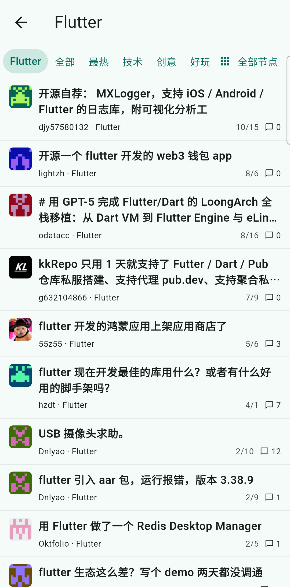

# V2DO

V2DO 是一个使用 Flutter 开发的 V2EX 与 LINUX DO 第三方客户端，界面以 Android 为优先。它与两个论坛均无官方关联。

## 界面预览

以下为 Android 实机截图，展示 V2EX 主页、主题详情、节点和搜索。截图包含论坛用户公开发布的内容；相关内容及头像属于各自权利人。

   

## 功能

- 浏览主题、节点与分类，查看正文、回复和图片，发帖与回帖。
- 回复排序、只看楼主、楼中楼展示及折叠；支持站点所提供的回复关系。
- 个人资料、收藏、消息、浏览记录；支持 V2EX 签到和余额记录。
- LINUX DO 帖子搜索；V2EX 支持应用内节点、用户建议和 SoV2EX 帖子搜索。
- LINUX DO 图片上传；V2EX 编辑器支持登录 Imgur 后上传图片。
- 主题颜色、深浅模式、字体大小和中英文切换；图片预览与保存、启动论坛选择。
- Android 可选 ECH 连接及检测；默认关闭，可分别查看两个论坛的检测结果。

部分功能需要登录或论坛授予相应权限。WebView 用于登录与网站验证；论坛页面解析及非公开接口可能随网站调整失效。Imgur 网页登录不支持 Google 登录，需要使用账号密码。

## 平台状态

Android 已构建并在设备上测试。iOS 尚无工程和平台接口实现，不能运行或发布。

## 开发方式

本项目全程使用 OpenAI Codex 协助开发，包括需求梳理、代码编写、测试和发布准备。根据项目维护者估算，开发过程大约消耗了 ChatGPT Plus 账户的 3 个周额度；这是粗略估计，并非独立统计的精确用量或费用。截至 2026 年 11 月 17 日，本次开发会话记录了 61 轮（含本轮及 4 轮未完成的尝试），共 106 条用户消息（包含追问和选择项回复）；统计会随后续开发变化。

## Android 安装包

Release 提供通用 APK 和按 CPU 架构拆分的 APK。大多数现代 Android 手机可使用 `arm64-v8a`；较旧的 32 位 ARM 设备可使用 `armeabi-v7a`，部分模拟器可使用 `x86_64`。不确定架构时请选择通用包。所有正式 APK 使用相同应用 ID、版本号和签名。

## 构建与测试

已使用 Flutter 3.47.9、Dart 3.13.7 和 Android SDK 36 构建。

```sh
flutter pub get
flutter analyze
flutter test
flutter build apk --release
```

Android release 构建从环境变量 `V2DO_KEYSTORE`、`V2DO_STORE_PASSWORD`、`V2DO_KEY_PASSWORD` 和 `V2DO_KEY_ALIAS` 读取签名配置。密钥和密码不得提交到仓库，应由维护者妥善备份。Debug 与正式包使用不同应用 ID 和签名，可以并存；登录状态和本地数据互不共享。

Android ECH 引擎源码位于 `android/ech`，预构建库位于 `android/app/src/main/jniLibs`。Windows 下可使用 Go 1.26.11 和 Android NDK 28.2.13676358，运行 `android/ech/build.ps1 -NdkPath <NDK目录>` 重新编译三个架构。Go 的许可证随源码提供。

Android 正式版的应用内更新使用 GitHub Releases，构建时需配置 `--dart-define=GITHUB_REPOSITORY=wshhfy/V2DO`。应用会选择适合设备架构的 APK，在应用内下载并校验摘要、包名和签名，再请求系统安装。v0.20.13 检查到更新后会直接下载；v0.20.14 及后续版本会先征求用户确认。Android 系统可能要求允许安装未知应用或确认安装；自动安装取决于系统策略。测试版与正式版应用标识不同，不会相互覆盖。未配置仓库时不会检查更新。

## 安全与隐私

- **无项目自建服务器：**V2DO 不使用项目维护者运营的账号服务器、中转服务器或统计上报服务器。论坛相关请求由应用直接发送到对应网站；本项目代码未集成自建的用户行为统计或广告服务。
- **登录与本地数据：**登录和网站验证使用应用内 WebView。网站登录会话由设备上的 WebView 管理，应用使用相应会话请求论坛数据；设置和本地浏览记录等也保存在设备上。设备系统或备份服务的数据处理受其自身设置和规则约束。
- **论坛以外的连接：**V2EX 帖子搜索会将搜索词发送给 SoV2EX；使用 Imgur 图床时，会连接 Imgur 并上传用户选择的图片；检查和下载更新会访问 GitHub 及其下载服务。这些功能的第三方服务各自处理其收到的数据。
- **ECH 和安全 DNS：**ECH 默认关闭。开启后，Android 的论坛数据请求会并发查询 Google Public DNS、Cloudflare DNS 和阿里公共 DNS，获取论坛域名的地址和 ECH 配置，并尝试连接论坛使用的 Cloudflare 地址。DNS 服务会收到所查询的论坛域名及连接信息。ECH 会加密 TLS 握手中的部分信息，不提供匿名性；登录验证网页使用原有连接方式。检测使用两个论坛的公开 `/cdn-cgi/trace` 地址，不使用论坛账号。连接失败时可关闭 ECH。
- **论坛内容与验证：**头像、帖子图片等可能来自论坛使用的 CDN 或其他图片服务器；加载它们时会连接相应服务器。登录或验证网页也可能加载其自身依赖的第三方资源。访问外部链接时，连接目标取决于链接内容。相关服务器通常能看到网络请求信息，例如 IP 地址。
- **更新校验：**应用内下载的正式更新包会校验 GitHub 提供的 SHA-256 摘要，并核对应用标识、版本号及与已安装应用一致的签名，再交由 Android 安装。请优先从本仓库的 Releases 获取安装包。

这些说明基于当前项目代码，并不代表对第三方网站、依赖或所有运行环境进行过独立安全审计，也不能保证绝对安全。论坛与第三方服务的数据处理方式以其各自的隐私政策为准。

## 许可证与第三方内容

本项目中由项目维护者有权授权的源码和文档以 [MIT License](LICENSE) 发布，版权署名为 `wshhfy`。其他贡献者保留其贡献的相关权利。

V2EX、LINUX DO、SoV2EX、Imgur 的名称及标识属于各自权利人；截图、帖子、回复和头像等论坛内容的权利属于相应权利人。MIT 授权不会改变上述第三方内容的权利。项目包含的第三方依赖和素材遵循各自的许可与使用条件；论坛标识、官网示意图和截图的具体授权情况需在公开发布前进一步核实。

## 服务与免责声明

V2DO 是独立开发的第三方客户端，与 V2EX、LINUX DO、SoV2EX 和 Imgur 无官方关联，也未获得其官方背书。论坛内容由相关网站及用户提供，项目不保证第三方内容的准确性或完整性。

软件按 MIT 许可证中所述的“现状”提供。论坛网页结构、接口、访问权限和第三方服务可能变化，功能可能不可用；适用法律所规定的权利不受本说明影响。

如有素材权利或其他问题，可通过仓库 Issues 联系维护者。


